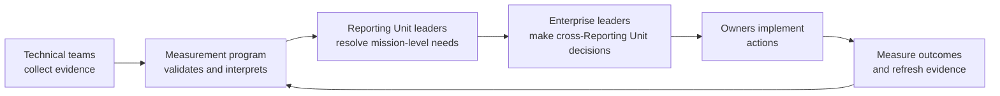
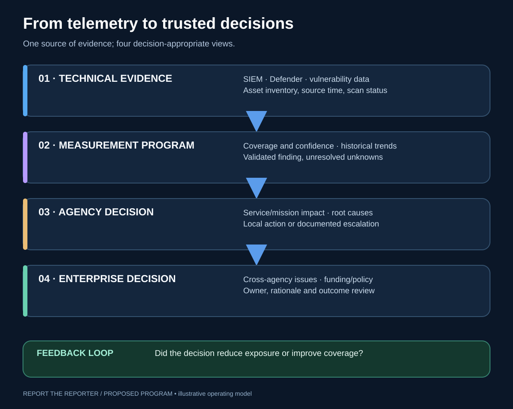

# Report the Reporter
## Enterprise Cybersecurity Measurement & Decision Support Program

**Status:** PROPOSED — reference program design, not an approved or deployed security assessment.  
**Purpose:** Convert continuous technical evidence into *defensible decisions*, track outcomes, and avoid the recurring cycle of dashboards that never change anything.

> **The operating question:** What persistent condition needs a decision, how confident are we in the evidence, who can act, and did the action work?

### Start here (choose one path)

| I need to… | Open |
|---|---|
| Understand this in two minutes | [START HERE](START-HERE.md) |
| Brief a leader with visuals | [Leadership briefing kit](briefings/README.md) |
| Define or approve the program | [Program charter](program/01-charter.md) |
| See who owns the work | [Governance & RACI](program/02-governance.md) |
| See how a finding is escalated | [Decision & escalation rules](program/04-decision-and-escalation.md) |
| Choose technical measurements | [Metric catalog](metrics/README.md) |
| Implement an initial pilot | [90-day pilot plan](program/06-pilot-roadmap.md) |
| Review the standards | [Standards map](references/standards-map.md) |

### How it works

**What this is not:** A universal security score, an automatic vulnerability-to-budget machine, a claim that telemetry proves an Reporting Unit is secure, or a replacement for incident escalation.

**Scope:** Public, vendor-neutral program templates with *illustrative* examples. No live Reporting Unit findings, production queries, internal inventory, or sensitive operational configurations should be committed here.

## Visual quick launch

[**OPEN THE VISUAL PRESENTATION KIT**](briefings/README.md) — four full-size SVG slides you can open directly from GitHub:

- [Technical evidence → program → leadership](briefings/visuals/01-operating-model.svg)
- [One finding, four leadership views](briefings/visuals/02-four-views.svg)
- [Decision quality gates](briefings/visuals/03-decision-gates.svg)
- [Example executive decision panel](briefings/visuals/04-executive-panel.svg)

### Key research upgrades (November 2026)

- [**NIST IR 8286 risk-to-decision bridge**](program/07-risk-to-decision-bridge.md): avoid confusing a measured control weakness with an approved enterprise risk scenario.
- [**Reporting Unit service participation and applicability**](program/08-Reporting Unit-applicability-and-services.md): don't treat different scopes, inherited controls, and monitoring coverage as equivalent.
- [**Program outcome and accountability review**](program/09-outcome-review-and-program-health.md): monitor whether decisions happened and had the intended effect.
- [Research findings and primary sources](references/research-notes-2026-11.md).

## Optional interactive component (HTML)

The **documentation and program guidance remain the main project**. An optional, offline [Decision Wizard](components/decision-wizard/README.md) demonstrates the evidence → interpretation → decision → outcome workflow using fictional inputs. [View its HTML source](components/decision-wizard/index.html). To interact with it, download or clone the repository and open `components/decision-wizard/index.html` in a browser; GitHub does not execute HTML file previews.

- **Terminology:** [Organization / Reporting Unit glossary](references/terminology.md). All core examples use capability categories, not specific product stacks.
- **Not operational software:** no integrations, accounts, data persistence, approved security scores or automatic risk acceptance.

### Program artifacts
- [Charter](program/01-charter.md) · [Governance](program/02-governance.md) · [Operating cycle](program/03-operating-cycle.md) · [Decision tree](program/04-decision-and-escalation.md) · [Evidence and disputes](program/05-evidence-quality-and-disputes.md) · [Pilot](program/06-pilot-roadmap.md)
- [Architecture](implementation/architecture.md) · [Data contracts](implementation/evidence-and-history-model.md)
- [Metric catalog](metrics/README.md) · [Metric specification template](templates/metric-specification.md) · [Decision record template](templates/decision-record.md)
- [Leadership briefing kit](briefings/README.md) · [Standards map](references/standards-map.md)

### Governing principle

A metric without a defined decision, applicable scope, evidence quality, accountable owner and follow-up is **an observation**, not a leadership KPI.

*Maintainer note: this repository is a proposed implementation aligned with published guidance; it is not an official NIST, CIS, or CISA publication.*