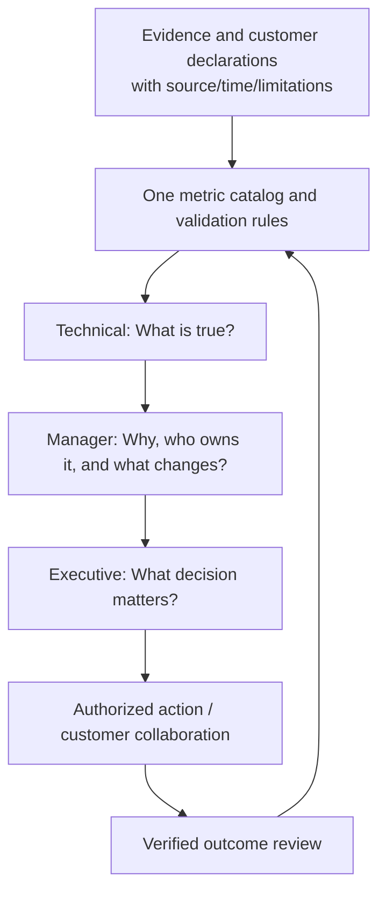
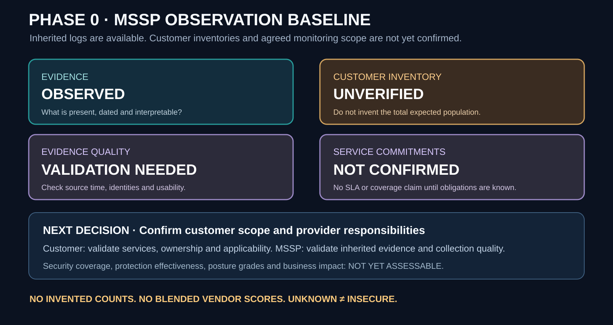

# Report the Reporter
## Managed Cybersecurity Assurance & Performance Program (proposed)

**Status:** Proposed, vendor-neutral MSSP measurement and decision-support program. Not an approved customer security assessment, operational dashboard, official risk score, or deployed service.

**Purpose:** Turn technical observations into clear, defensible measurements, responsible communication, useful decisions and verified outcomes **across multiple customers**. Distinguish (1) customer security outcomes, (2) MSSP service assurance, and (3) the trustworthiness / limits of the underlying evidence.

> **The governing question:** What can we responsibly claim, what remains unknown, what decision is needed, who owns the action, and did it work?

### Start with the program, not the implementation

| Need | Read |
|---|---|
| **Understand the MSSP model and boundaries** | [Measurement strategy](program/10-measurement-strategy.md) |
| **Know what leadership should see** | [12 executive decision themes](metrics/executive-decision-catalog.md) |
| **See which metrics are introductory vs mature** | [Measurement adoption roadmap](metrics/measurement-adoption-roadmap.md) |
| **Explore metrics that might support those themes** | [46 candidate measures](metrics/master-metric-catalog.md) |
| **Trace the three reporting levels** | [Executive → management → technical crosswalk](metrics/three-level-crosswalk.md) |
| **Start with logs but no validated customer context** | [Phase 0 observation baseline](metrics/phase-0-observation-baseline.md) |
| **Use trustworthy labels and explain unknowns** | [Evidence and reporting rules](metrics/evidence-and-reporting-rules.md) |
| **Explain the program visually** | [Three-audience diagram](briefings/visuals/05-three-audience-measurement.svg) / [Phase 0 diagram](briefings/visuals/06-phase-0-baseline.svg) |
| **Define and approve a metric** | [Metric specification](templates/metric-specification.md) |
| **Review the public sources** | [Research source review](references/measurement-source-review-2026-11-18.md) |
| **See governance, decisions and pilot guidance** | [Program charter](program/01-charter.md) / [Program index](START-HERE.md) |

### One integrated measurement program

The program *uses concepts* from [NIST SP 800-55](references/standards-map.md) (measurement), NIST SP 800-137 (continuous monitoring), NIST CSF / CISA CDM (outcome organization and cross-customer visibility), NIST IR 8286 (risk handoff), and exposure-management practice (e.g., CTEM). **These are complementary references, not four things to build independently.**

### The most important initial condition

**Phase 0:** New MSSP with inherited log access, **before** customers have confirmed their inventories, responsibilities, critical services or service commitments. Start with observable evidence, source usability, provenance, tentative attribution and questions to validate. **Do not fabricate device totals, coverage percentages, risk grades, missed-SLA claims, or 'fully protected' judgments.**

### What belongs in this program

- Executive decision questions; one canonical candidate metric catalog; definitions; example *types* of supporting evidence.
- Clear customer applicability, service-scope assumptions, reporting limitations, measurement-readiness rules and review language.
- Executive, manager and technical communication of the **same evidence**.
- Customer-provider responsibility boundaries, authorized decision routing, outcome reviews and metric maintenance.

**Out of scope here:** dashboard software, platform selection, queries, connectors, permissions, RBAC, data tenancy implementation, service credentials, APIs, deployment pipelines and storage architecture. Implementation choices belong to a separate engineering workstream.

### Existing supporting materials

- [Program governance](program/02-governance.md), [operating cycle](program/03-operating-cycle.md), [risk-to-decision guidance](program/07-risk-to-decision-bridge.md), [customer and service applicability](program/08-agency-applicability-and-services.md), [program effectiveness](program/09-outcome-review-and-program-health.md).
- [Initial measure examples](metrics/README.md), [presentation kit](briefings/README.md), [standards map](references/standards-map.md).
- **Optional demonstration only:** [HTML decision wizard](components/decision-wizard/README.md), including ELI5 mode. It is not the program and does not prove customer coverage.

**Safety:** This public repo contains fictional examples and general documentation only. Do not commit actual customer inventories, restricted findings, production logs, operational credentials, or regulated information.

**Principle:** A metric without a suitable scope, credible evidence, an authorized decision, clear limitations and an outcome check is an observation—not an executive assurance claim.
