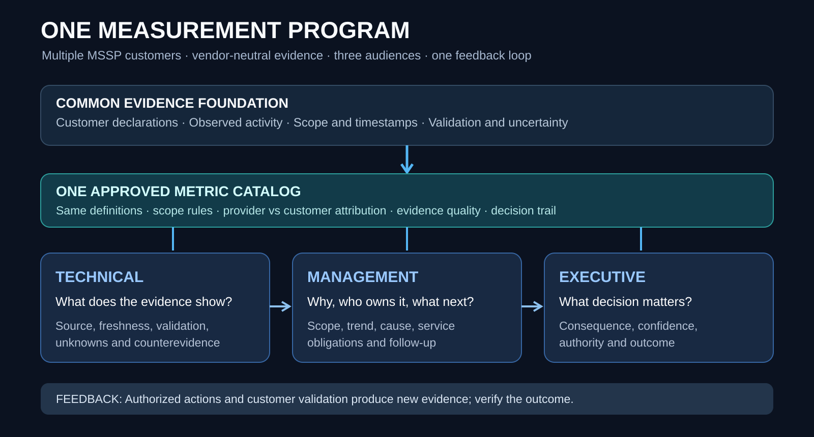

# Start here — MSSP measurement program

We are not trying to recreate every vendor scorecard. We are creating **one shared way to answer leadership questions** across different customers and security services, without confusing "what we can see" with "everything that exists."

## Choose a path

| If you need to… | Go here |
|---|---|
| Get the full program rationale and scope | [MSSP strategy](program/10-measurement-strategy.md) |
| Select executive questions | [Executive decision catalog](metrics/executive-decision-catalog.md) |
| Browse candidate metrics | [Master metric catalog](metrics/master-metric-catalog.md) |
| See the same measure at three reporting levels | [Reporting crosswalk](metrics/three-level-crosswalk.md) |
| Begin with only inherited logs | [Phase 0: observation baseline](metrics/phase-0-observation-baseline.md) |
| Avoid overclaiming data | [Evidence and reporting rules](metrics/evidence-and-reporting-rules.md) |
| Share the picture | [Three-level visual](briefings/visuals/05-three-audience-measurement.svg) and [Phase 0 visual](briefings/visuals/06-phase-0-baseline.svg) |
| Define one approved metric | [Metric template](templates/metric-specification.md) |
| Explain roles, decisions and risk translation | [Governance](program/02-governance.md) and [risk bridge](program/07-risk-to-decision-bridge.md) |
| Inspect standards and sourcing | [Research source review](references/measurement-source-review-2026-11-18.md) |
| Explore an optional teaching component | [HTML wizard / ELI5](components/decision-wizard/README.md) |

## The 30-second explanation

"We are an MSSP serving multiple customers. We inherit observations, validate how reliable and complete they are, and turn suitable findings into customer and leadership decisions. We separately report our service performance, customer conditions and the limits of our visibility. Every consequential decision should have someone who can act and a later outcome check."

### What comes first?

**Start with Phase 0.** Logs exist; customer inventories, critical services, expected monitoring sources and provider/customer obligations may not yet be confirmed. Present **what evidence we have, what it could support, what remains unknown, and the confirmations required**—without pretending to know total counts.

The catalog and reporting approach are **proposals** requiring local review, not mandated standards, production measures or formal customer risk acceptance.

**Next practical step:** Choose the first 3–5 executive *questions* from the catalog, then approve their supporting definitions as the needed customer/evidence prerequisites become available.
