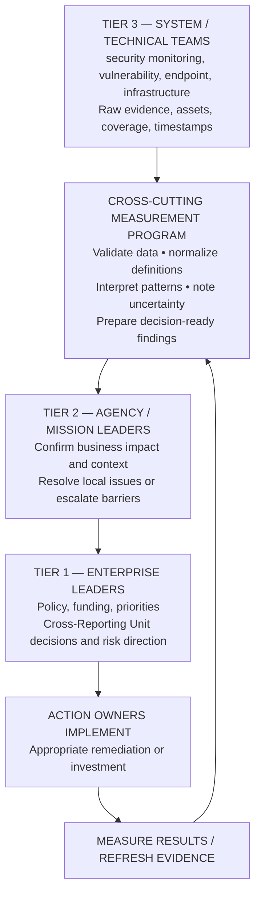

# Visual 1 — Evidence → program → leadership

**Presenter note:** The blue-sky goal is not for operators to make unapproved risk decisions. They supply reliable facts. The cross-cutting program makes those facts useful. Reporting Unit representatives provide mission context and executives make decisions within their authority.

**Accuracy note:** Only the organization/mission-system Tier 1/2/3 structure is based on NIST SP 800-137. The boxed 'measurement program' is our proposed coordination function, not a fourth NIST tier.