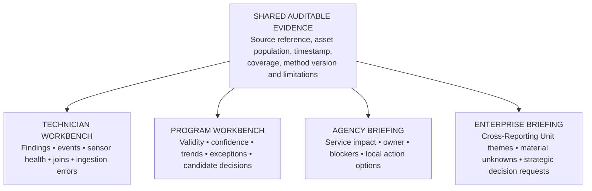

# Visual 2 — Same evidence, four presentation layers

| Audience | Show first | Drill into | Typical decision |
|---|---|---|---|
| Technician | What broke / what was measured | Event/finding, asset, source timestamps | Investigate or remediate |
| Measurement program | What can be asserted responsibly | Denominator, coverage, quality, trends, interpretation | Publish, defer, challenge, escalate |
| Reporting Unit leader | What affects mission outcomes | Local constraints, exceptions, action owners | Prioritize/local resource allocation |
| Enterprise leader | What requires enterprise authority | Cross-Reporting Unit trend, alternatives, evidence and outcomes | Fund, change policy, monitor/accept within authority |

**Presenter note:** We are not preparing four independent reports. They share a governed measurement and evidence trail, with role-based access.