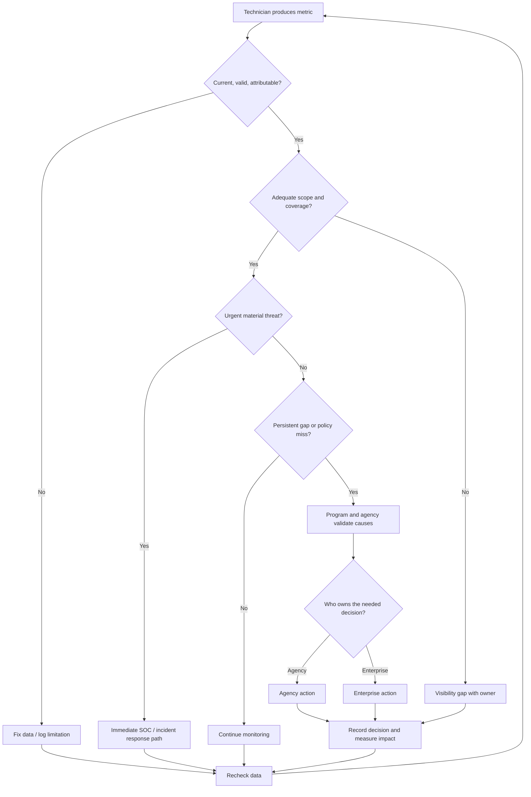

# Visual 3 — Escalation decision tree

**Presenter note:** This protects leaders from making funding decisions based solely on an alert spike or late scanner refresh. Urgent threats do not wait for the monthly review. Missing visibility is reported explicitly instead of being interpreted as secure.