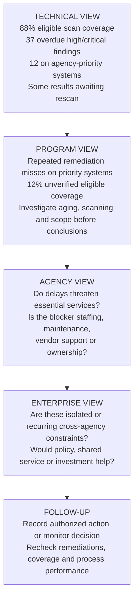

# Visual 4 — One vulnerability issue, four audience views

> **All values below are fictional examples for demonstration.**

## Translation table

| Layer | What is said | What isn't claimed |
|---|---|---|
| Technician | 37 findings overdue in assessed scope; 88% eligible scan coverage | The remaining 12% is clean |
| Program | Persistent remediation trend requires verification; limitations disclosed | Raw findings prove funding need |
| Agency | Priority services may face continued exposure; determine root cause | All services are equally affected |
| Enterprise | Shared intervention may be justified *if* common barriers are confirmed | One agency snapshot proves enterprise failure |

**Presenter note:** If findings are remediated after a snapshot, the snapshot is still a historical observation. The current status and validation time must be disclosed before making a current decision.