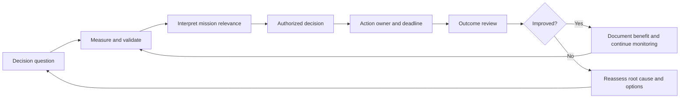

# Visual 5 — Why the dashboard won't die

## What makes it a program
- A named sponsor and owner survive leadership turnover.
- Stable, approved metric definitions avoid dashboard drift.
- Findings lead to a decision owner and action or deliberate monitoring.
- Outcomes get checked, not just presented.
- The backlog of unanswered questions shapes the next measures to create.

## Exit slide
**Request:** approve a small scoped pilot with governance and a decision cycle. **Not requested:** another dashboard purchase or an unsupported Reporting Unit security ranking.