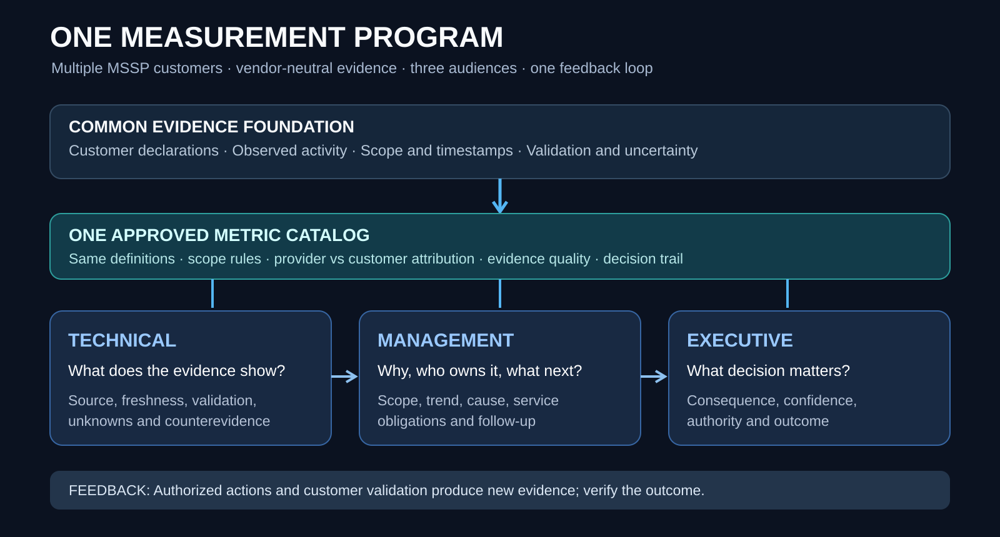

# Briefing and visual explanation kit

**The current program's canonical reporting model uses three audience views:** **executive**, **technical management** and **technical**. Customer validation and risk assessment are necessary handoffs, *not* separate software dashboards.

## Start with the updated program visuals

1. **[One evidence foundation → three connected audiences](visuals/05-three-audience-measurement.svg)** — why the same definitions feed all leadership levels.
2. **[Phase 0 / inherited logs / no denominator](visuals/06-phase-0-baseline.svg)** — what can be responsibly presented before customer inventories and expected monitoring scope are agreed.

These diagrams use **qualitative** statuses, not made-up customer numbers, and can be opened directly from GitHub.

## Existing general-purpose briefing assets

These *older* illustrative materials remain as supporting examples. Their additional "program" or "customer" conversation may appear as a fourth step; that is **not** a change to the current three-dashboard architecture.

- [Original operating model](visuals/01-operating-model.svg)
- [Original four-conversation diagram](visuals/02-four-views.svg)
- [Original decision gates](visuals/03-decision-gates.svg)
- [Original executive sample panel](visuals/04-executive-panel.svg)
- [One-page briefing](00-one-page-brief.md)
- [Evidence-to-decision text](01-evidence-to-decision.md) · [Presentation layers](02-presentation-layers.md) · [Decision gates](03-decision-tree.md) · [Vulnerability walkthrough](04-vulnerability-walkthrough.md) · [Feedback](05-feedback-loop.md)

For the words and evidence fields to put into those three dashboard views, see the [three-dashboard reporting blueprints](three-dashboard-reporting-blueprints.md) and the [reusable report pack](../templates/three-level-reporting-pack.md).

## Presentation order for a first MSSP takeover conversation

1. Show [Phase 0 baseline](visuals/06-phase-0-baseline.svg).
2. Explain the [evidence and language rules](../metrics/evidence-and-reporting-rules.md): what we can claim and what we cannot.
3. Show [three connected levels](visuals/05-three-audience-measurement.svg).
4. Propose [starter metrics](../metrics/starter-metric-cards.md) and the concrete customer/provider scope questions they create.
5. Ask for an explicit decision to establish source ownership and customer service scope, then set an outcome review.

Use fictional / generic information only. This repository may be public.
