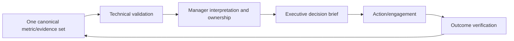

# Three dashboard reporting blueprints — program content, not software design

**Status: proposed program reporting specification.** These are **what questions, wording, decisions and evidence each audience sees**, not page-layout code, permissions, product choices, integrations or implementation requirements. Use the [same canonical metric IDs](../metrics/decision-to-measure-traceability.md) and supporting evidence for all audiences.

## Shared publication contract

Every reported item should identify:
- **Question / measure ID and definition version**; **customer or provider context** (only when validated); **observation date/window**; and **what is actually known**.
- **Applicability**, **adoption horizon** (START/BUILD/MATURE), **measurement status** (not assessed, engagement requested, definition in progress, awaiting validation, measured, not applicable), and **evidence quality**—not collapsed into one number.
- **Consequence and boundary**: business impact validated / unvalidated; customer-owned versus provider-owned issue versus unresolved.
- **Decision or next validation request**, accountable role, next review, and what outcome would count as progress.

Not every item needs a numeric metric; a credible qualitative observation or justified unknown can be a program output.

## 1. Executive view — decisions and confidence

**Reading order**

1. **Summary of what is supportable** for the current reporting period.
2. **Material service or customer conditions** with verified context and limitations (not all vendor alarms).
3. **Blind spots / unassessed questions** that change confidence or require cooperation.
4. **Decisions awaiting leadership**, each with available options and appropriate authority.
5. **Previous decisions and observed results**; do not show success without the agreed verification.

**During inherited-log discovery:** Show evidence available, attribution uncertainty, scope not established, source usability, customer-contact requests, provider data-quality work. Leave risk, coverage, control effectiveness and recovery values **not assessed**, with a constructive next-step message.

**When mature:** Add validated material exposure, detection/response outcomes, service assurance, resilience tests and action outcomes for each applicable customer. Do not combine incomparable customer populations into a score.

## 2. Technical management view — explanation and coordination

**Reading order**

1. Group by customer/capability *only when attribution is sufficiently supported*; otherwise use **Unresolved attribution**.
2. Show measure or candidate, its adoption stage, eligible cohort/source of truth, evidence sufficiency, trend validity and known uncertainty.
3. Separate **provider service problem**, **customer-owned security work**, **shared/unknown responsibility**, and **risk-owner review**.
4. Track validation request, work owner, blocker, latest customer response, next review, and whether the executive summary can be changed.

**During inherited-log discovery:** The manager's top story is a **validation queue**, not a league table of customer threat counts.

## 3. Technical view — reproduce the evidence

**Reading order**

1. Relevant observations/source classes and observation windows, with provenance.
2. Quality checks: timestamp validity, source identification, duplication, scope attribution, relevant field semantics, and missingness.
3. Which specific questions can be answered from the records and which require customer declarations or independent testing.
4. Counterevidence/unknowns and the **minimum additional evidence** needed to make a scoped claim.
5. Proposed technical investigation or validation—not an automatic escalation from a raw count.

**During inherited-log discovery:** The technical view can report observed source types and reproducible limitations without suggesting inventory completeness.

## Example: one discovery issue shown three ways (no invented counts)

| Audience | Statement | Required next action |
|---|---|---|
| **Executive** | "We can inspect inherited event records, but customer scope and expected monitoring obligations are not yet validated. Coverage claims are therefore not assessable." | Approve customer/provider scope-confirmation work |
| **Management** | "Attribution and expected-source questions are unresolved; provider evidence usability is being evaluated separately." | Assign customer review and provider validation owners |
| **Technical** | "Representative records have source identifiers and timestamps. Customer mapping and expected populations require independent checks." | Reconcile evidence quality and identity conflicts |

## Example: a developing recovery-capability issue

| Audience | Introductory reporting (not a failed test) | Mature reporting once eligible |
|---|---|---|
| Executive | "Recovery performance is not assessed because critical-service objectives and testing evidence have not been established." | "Approved objectives exist; exercise outcomes show whether they were met." |
| Manager | "Engage service owners to identify recovery priorities and establish an exercise plan." | "Review exceptions, test failures, lessons learned and scheduled verification." |
| Technical | "Current security logs do not establish service restoration times." | "Use actual exercise timestamps, restored-service checks and integrity evidence." |

## Anti-patterns to avoid

- A dark-red "0% recovery" tile when no test or approved recovery objective exists.
- A green "100% monitoring" tile with only provider-observed logs as denominator.
- A composite grade averaging DDoS, endpoint, web, identity and scanning vendor scores.
- Executive alerts for transient volume spikes without relevant outcome or decision.
- Confidence marked "high" because a vendor supplied precise decimals.
- A customer failing a capability it has not subscribed to and does not own.

## Report generation and review sequence

Do not create three competing definitions or independent scoreboards. The [example reporting pack](../templates/three-level-reporting-pack.md) can be filled with approved non-sensitive examples; never publish real customer data to this public repository.
