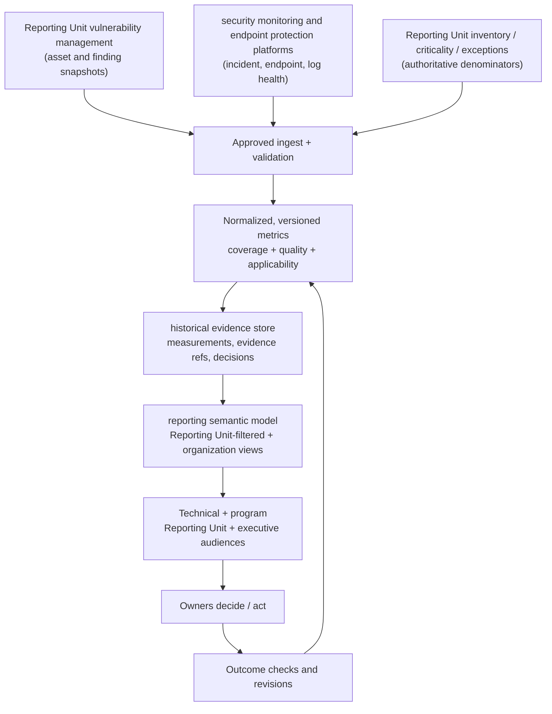

# Reference architecture — tools support the program

## Capability alignment (illustrative)
- **Security monitoring and event management:** incidents, alert context, expected log sources and collection health.
- **Endpoint protection capability:** device inventory and telemetry health, subject to authoritative inventory validation.
- **Vulnerability assessment source:** findings and rescan evidence; normalize rather than treating vendor grades as a common enterprise standard.
- **Historical evidence store:** persistent time-series snapshots, source identifiers, revision history and materialized reporting data.
- **Reporting and presentation layer:** audience-specific reporting over governed measures. Use RLS and effective permissions appropriate to Reporting Unit boundaries; do not assume dashboard filters alone enforce isolation.

## Recommended logical layers
1. **Raw/source:** immutable or revision-preserving snapshots with source/update/ingest timestamps; follow retention and licensing rules.
2. **Reference:** Reporting Unit registry, asset ownership, criticality, service participation, expected log-source inventory, eligibility and exceptions.
3. **Metric:** approved formulas, numerator, denominator, coverage and confidence, threshold and methodology version.
4. **Decision:** validated issue, assigned action, approver, review dates, risk acceptance and outcome.
5. **Presentation:** distinct role views backed by common semantics and evidence lineage.

## Security and engineering requirements
- Prefer read-only source connectors with least privilege and service identities.
- Enforce Reporting Unit-level data isolation in the query/data access layer, not just the visualization.
- Define source freshness and ingestion observability; alert on pipeline failures.
- Keep a historical event state model to distinguish finding observed, remediated, verified and unknown.
- Maintain versioned calculations and backfill annotations.
- Store sensitive evidence in governed enterprise systems; only reference opaque IDs in shared briefing artifacts.
- Review actual vendor APIs, licensing and retention prior to implementation.

**Important:** this is a reference pattern, not deployed infrastructure. 