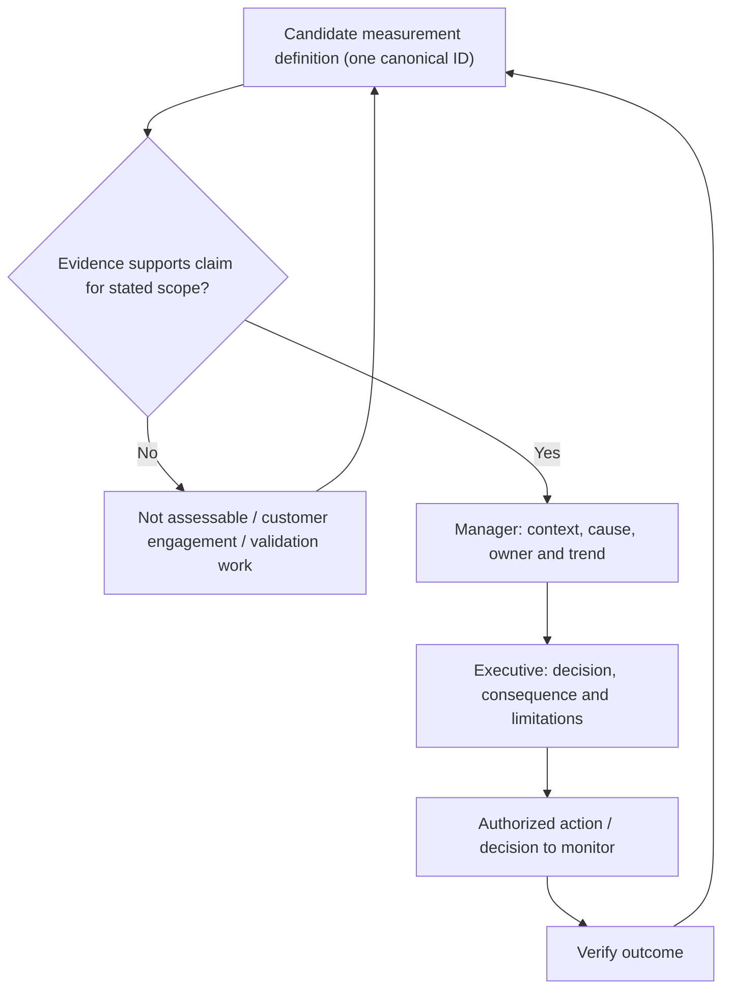

# Complete decision-to-measure traceability (all 46 candidate metrics)

**Proposed cross-reference; not 46 executive KPIs.** This page maps every candidate metric in the [master catalog](master-metric-catalog.md) to one **primary** executive decision theme and, when helpful, a **secondary** theme. It does **not** imply every candidate is suitable for immediate executive publication.

**Important:** A metric may serve multiple decisions while having **one canonical definition**. Do not duplicate the measurement just because it contributes to another dashboard conversation.

## Full cross-reference

| Candidate ID | Primary executive decision | Secondary use | Reason or guardrail |
|---|---|---|---|
| [V01](master-metric-catalog.md) | [E01](executive-decision-catalog.md) | — | Evidence classes support discovery, not customer coverage |
| [V02](master-metric-catalog.md) | [E03](executive-decision-catalog.md) | E01 | Attribution requires validation |
| [V03](master-metric-catalog.md) | [E01](executive-decision-catalog.md) | E03 | Inventory reconciliation provides the denominator |
| [V04](master-metric-catalog.md) | [E01](executive-decision-catalog.md) | E02 | Expected-source coverage requires an agreed expected population |
| [V05](master-metric-catalog.md) | [E03](executive-decision-catalog.md) | E01 | Unreconciled identities are not proved missing systems |
| [P01](master-metric-catalog.md) | [E02](executive-decision-catalog.md) | E01 | Last-seen evidence is not automatically an SLA breach |
| [P02](master-metric-catalog.md) | [E02](executive-decision-catalog.md) | E06 | Sample usability is not end-to-end detection effectiveness |
| [P03](master-metric-catalog.md) | [E06](executive-decision-catalog.md) | E02 | An active rule is not a successful controlled detection |
| [P04](master-metric-catalog.md) | [E02](executive-decision-catalog.md) | — | Assess only confirmed provider commitments |
| [P05](master-metric-catalog.md) | [E02](executive-decision-catalog.md) | — | Attribution of fault needs cause analysis |
| [P06](master-metric-catalog.md) | [E02](executive-decision-catalog.md) | E06 | Responsibility and timing depend on agreed service objectives |
| [EXP01](master-metric-catalog.md) | [E05](executive-decision-catalog.md) | E04 | KEV relevance needs asset/exposure validation |
| [EXP02](master-metric-catalog.md) | [E05](executive-decision-catalog.md) | E04 | Age needs verified current state and target |
| [EXP03](master-metric-catalog.md) | [E05](executive-decision-catalog.md) | E01 | Scan coverage depends on eligible confirmed assets |
| [EXP04](master-metric-catalog.md) | [E05](executive-decision-catalog.md) | E12 | Verified remediation outcome, not disappeared finding |
| [EXP05](master-metric-catalog.md) | [E04](executive-decision-catalog.md) | E05 | Exposure path is not quantified business risk |
| [D01](master-metric-catalog.md) | [E06](executive-decision-catalog.md) | E02 | Investigative evidence can be profiled in discovery |
| [D02](master-metric-catalog.md) | [E06](executive-decision-catalog.md) | — | Requires agreed use cases and controlled tests |
| [D03](master-metric-catalog.md) | [E06](executive-decision-catalog.md) | E02 | Clock and severity definition must be approved |
| [D04](master-metric-catalog.md) | [E06](executive-decision-catalog.md) | — | Containment depends on actual responder authority |
| [D05](master-metric-catalog.md) | [E06](executive-decision-catalog.md) | E12 | Technical lessons need outcome verification |
| [I01](master-metric-catalog.md) | [E07](executive-decision-catalog.md) | — | Privileged population must be customer-confirmed |
| [I02](master-metric-catalog.md) | [E07](executive-decision-catalog.md) | — | A recorded access review may not prove action |
| [I03](master-metric-catalog.md) | [E07](executive-decision-catalog.md) | — | No sign-in does not mean unauthorized dormant identity |
| [I04](master-metric-catalog.md) | [E07](executive-decision-catalog.md) | — | Requires actual effectiveness tests |
| [N01](master-metric-catalog.md) | [E09](executive-decision-catalog.md) | E01 | Observed edge traffic does not establish protection scope |
| [N02](master-metric-catalog.md) | [E09](executive-decision-catalog.md) | E10 | Requires disruption testing and mission objectives |
| [N03](master-metric-catalog.md) | [E09](executive-decision-catalog.md) | — | App applicability and protection must be established |
| [N04](master-metric-catalog.md) | [E09](executive-decision-catalog.md) | E04 | Segmentation claim requires approved intended paths and test |
| [N05](master-metric-catalog.md) | [E09](executive-decision-catalog.md) | E01 | External identities need customer confirmation |
| [A01](master-metric-catalog.md) | [E08](executive-decision-catalog.md) | E04 | App owners and baseline needed for meaningful assessment |
| [A02](master-metric-catalog.md) | [E08](executive-decision-catalog.md) | — | Blocked events do not automatically mean data loss |
| [A03](master-metric-catalog.md) | [E08](executive-decision-catalog.md) | E10 | Data recovery needs integrity validation |
| [A04](master-metric-catalog.md) | [E08](executive-decision-catalog.md) | E04 | Cloud configuration issue may have limited business consequence |
| [R01](master-metric-catalog.md) | [E10](executive-decision-catalog.md) | E03 | Start with owner/objective engagement before recovery results |
| [R02](master-metric-catalog.md) | [E10](executive-decision-catalog.md) | — | Tests measure RTO/RPO outcomes; do not fabricate from logs |
| [R03](master-metric-catalog.md) | [E10](executive-decision-catalog.md) | E11 | Customer context determines true critical dependency |
| [R04](master-metric-catalog.md) | [E10](executive-decision-catalog.md) | E12 | Close only after corrective action outcome verified |
| [T01](master-metric-catalog.md) | [E11](executive-decision-catalog.md) | E03 | Supplier scope is not inferred from missing evidence |
| [T02](master-metric-catalog.md) | [E11](executive-decision-catalog.md) | — | Supplier self-attest is not independent verification |
| [T03](master-metric-catalog.md) | [E11](executive-decision-catalog.md) | E04 | Cross-customer correlation needs validated materiality |
| [G01](master-metric-catalog.md) | [E03](executive-decision-catalog.md) | E12 | Disputes require transparent review |
| [G02](master-metric-catalog.md) | [E12](executive-decision-catalog.md) | — | Decision-to-monitor is a legitimate disposition |
| [G03](master-metric-catalog.md) | [E12](executive-decision-catalog.md) | — | Action closure is not automatically improvement |
| [G04](master-metric-catalog.md) | [E04](executive-decision-catalog.md) | E12 | Risk decisions belong to authorized risk owners |
| [G05](master-metric-catalog.md) | [E12](executive-decision-catalog.md) | — | Program must retire useless measures |

## How a metric travels

A metric is **not promoted automatically** from a reporting category to an executive number. It must pass the existing evidence and decision gates and demonstrate why leadership would need to act.

## Example: recovery readiness is never just an RTO graph

- **Candidate R01 → E10**: Do we have identified priority services and owners with approved recovery objectives? Initially this may be only a *customer-engagement question*.
- **Candidate R02 → E10**: When objectives and exercises exist, do observed recovery results meet them? Until then, the metric's performance value is **not assessable**, not zero or failed.
- **Candidate R03 → E10, secondary E11**: Are dependencies important to service recovery? Ask service owners; observed network connections do not prove mission dependence.
- **Candidate R04 → E10, secondary E12**: Did the proposed corrective activity improve tested outcomes?

## Maintainer validation rules

- Each ID in the master catalog should occur exactly **once** in this table as a primary assignment.
- Every primary/secondary ID must exist in the 12-theme executive catalog.
- A new metric changes this crosswalk and the master catalog together, not four competing inventories.
- Read *adoption horizon* separately from *evidence sufficiency*; see [adoption roadmap](measurement-adoption-roadmap.md).
- The technical/management storytelling for the 12 decisions remains in the [three-level crosswalk](three-level-crosswalk.md).
