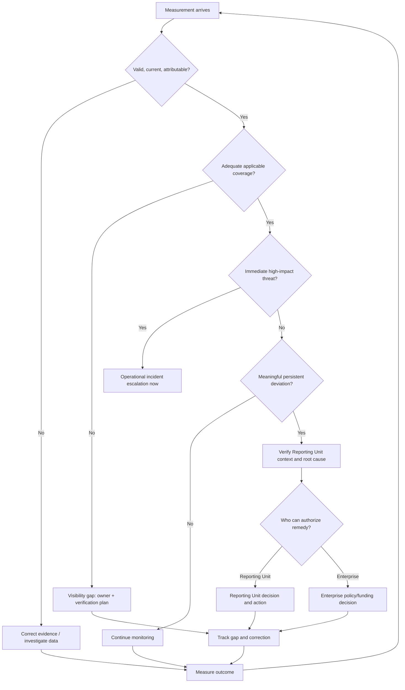

# Decision and escalation rules

## Guardrails
- **Do not** give missing or unmeasured data a numeric score of zero risk.
- **Do not** equate vendor scoring with an enterprise-approved risk assessment.
- **Do not** trigger executive escalations solely on raw counts.
- **Do** record denominator, exclusion rationale and participation rates.
- **Do** correlate duration, service criticality, exposure, compensating controls and confidence.
- **Do** let urgent operational incidents bypass routine program queues.
- **Do** show timestamps and possible changed-since-report status.
- **Do** have a documented feedback/appeal path.

## Escalation packet
Observation → evidence confidence → mission/business context → options and uncertainty → recommended owner/decision authority → deadline/trigger → follow-up metric.

No requested purchase is justified simply by a scanner backlog; first investigate why backlog persists.