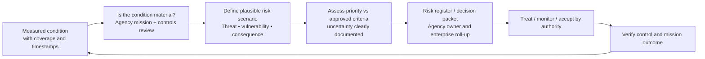

# Risk-to-decision bridge (proposed)

> **Research upgrade (Nov 2026):** The NIST IR 8286 series is the missing bridge between continuously measured controls and enterprise risk decisions. A metric is **not automatically a risk**. NIST SP 800-55 governs measures; SP 800-137 governs monitoring; NIST IR 8286 Rev. 1 and companions govern the way cybersecurity risks inform enterprise risk management.

## Two linked but different records

| Measurement record | Risk scenario / register record |
|---|---|
| "Of 100 eligible priority endpoints, 82 have healthy protection telemetry." | "If a threat affects priority service X while a relevant endpoint is unmonitored, detection and containment may be delayed, potentially disrupting service Y." |
| Records reproducible numerators, denominators, timestamps, coverage, methodology. | Records threat event, affected asset/mission, likelihood/impact assessment, assumptions, existing controls, risk owner, chosen response, review date. |
| Managed by measurement program with technical data owner. | Owned and assessed by authorized Reporting Unit/enterprise risk function; evaluated against approved risk criteria. |
| Reviewed continuously at operational cadence. | Updated on trigger, material change and governed risk review cadence. |

**Do not directly convert 82% into an 18% chance of compromise or into a dollar loss.** These would require a defensible model and supporting evidence. Unknowns can prompt an assessment without justifying a quantified risk claim.

## Translation sequence

## Local evaluation gates
1. **Evidence gate:** Is the observed condition true, sufficiently fresh, appropriately scoped and covered?
2. **Materiality gate:** Does it plausibly affect an Reporting Unit mission/service, compliance obligation, or shared operational capability? If unclear, request Reporting Unit validation.
3. **Risk scenario gate:** Describe an event and consequence, not merely a control score; identify existing safeguards.
4. **Priority gate:** Use approved risk appetite/tolerance and mission criticality. If risk likelihood/impact estimates cannot be defended, say so.
5. **Authority gate:** Determine whether the response belongs to Reporting Unit operations, central service, risk owner, or enterprise executive.
6. **Outcome gate:** Record the decision and verify whether the treatment changed exposure or mission outcome.

## Handoff to enterprise risk management (ERM)
Use approved Reporting Unit risk registers or an enterprise risk register **if these exist**; don't create a competing official register without leadership agreement. The program can publish candidate risk scenario packets for assessment. Enterprise aggregation should preserve Reporting Unit boundaries, dependencies, distinct causes and correlated risks; summing counts across Reporting Units does not produce enterprise risk exposure.

## References
- [NIST IR 8286 Rev. 1 — Integrating Cybersecurity and ERM](https://csrc.nist.gov/pubs/ir/8286/r1/final)
- [NIST IR 8286A Rev. 1 — Risk identification and estimation](https://csrc.nist.gov/pubs/ir/8286/a/r1/final)
- [NIST IR 8286B Update 1 — Prioritization and treatment](https://csrc.nist.gov/pubs/ir/8286/b/upd1/final)
- [NIST IR 8286C Rev. 1 — Staging for enterprise oversight](https://csrc.nist.gov/pubs/ir/8286/c/r1/final)
- [NIST SP 1308 — Cybersecurity, ERM and workforce management](https://csrc.nist.gov/pubs/sp/1308/final)

**Status:** This bridge is a proposed organizational process. NIST publications do not automatically authorize a local risk response or risk acceptance.